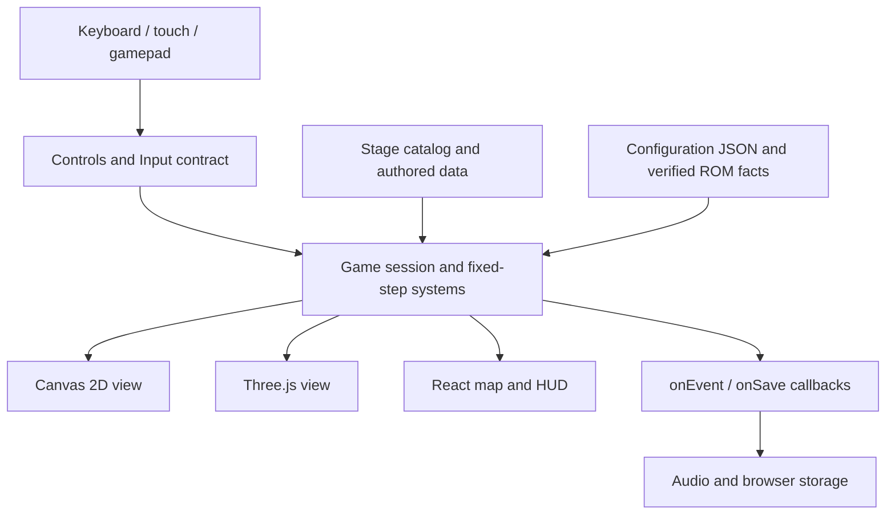

# Architecture

The game has one mutable simulation and multiple views of it. `Game.update`
advances a fixed step; React updates the interface at a lower cadence. Neither
renderer owns damage, jumps, barrel launches, animal charges or stage completion.

## Locate a bug

| Symptom                               | Start here                                                                                            |
| ------------------------------------- | ----------------------------------------------------------------------------------------------------- |
| Player catches on terrain             | `game/engine/gameSessionLevelQuery.ts`, `game/terrainLandMotion.ts`, `game/terrainCoralMotion.ts`     |
| Enemy contact, death or thrown barrel | `game/engine/playingFrame/enemyCombatStep.ts`, `enemyPlayerContact.ts`, `worldInteractThrown.ts`      |
| Cannon direction or trajectory        | `game/engine/playingFrame/stepCannonAndActions.ts`, `game/cannonMotion.ts`                            |
| Mount charge, glide or movement       | `game/engine/playingFrame/mountActionStep.ts`, `playerMotionHorizontal.ts`, `playerMotionVertical.ts` |
| Stage reset/spawn                     | `game/engine/gameLoadLevel.ts`                                                                        |
| Incorrect camera framing              | `game/camera.ts`, `game2d/camera2D.ts`, `scene/directorCamera.ts`                                     |
| Incorrect 2D boss scale               | `game2d/bossScene2dSprite.ts` and boss paint modules                                                  |
| Map navigation or mode selection      | `hooks/useAppMapActions.ts`, `components/MapConfirmPanel.tsx`, `islandMap/`                         |
| Sound or storage                      | `hooks/useAppGameBindings.ts`, `game/audio.ts`, `game/engine/save.ts`                                 |

Paths in this table are relative to `src/`.

## React shell layout

| Folder | Role | Import alias |
| ------ | ---- | ------------ |
| `containers/` | Wire hooks, session and callbacks; compose presentational components | `@containers/…` |
| `hooks/` | `useAppShell`, input/audio bindings, map/play actions | `@hooks/…` |
| `lib/` | Pure helpers (URL query, phase actions, session factories) with no JSX | `@lib/…` |
| `components/` | Presentational UI (HUD, overlays, controls, chrome primitives) | `@components/…` |

`App.tsx` stays thin: one shell hook, containers, and layout classes. Aliases are
configured in `tsconfig.app.json` and `vite.config.ts` (same pattern as `@game3d`).

## Contracts and responsibilities

`game/engine.ts` is the public facade. `engine/gameSession.ts` owns session state
and delegates to focused functions. `engine/playingFrame/updatePlayingFrame.ts`
orders the frame phases; the neighboring modules implement their rules.
Closely related helpers share a file instead of being hidden behind chains of
one-line forwarding modules.

`Level` describes authored data. `game/stageCatalog.ts` selects original/adapted
levels and defines supported presentation modes. The map imports that catalog;
it does not maintain a competing list. Numeric IDs are persisted save keys.
`Game.onEvent` and `Game.onSave` are small interfaces implemented by the app's
audio/storage bindings, so tests do not need those browser services.

These boundaries support SOLID in practical terms: each system has a focused
responsibility, new stage data uses the existing contracts, renderers share
simulation behavior, consumers use small interfaces and browser effects enter
through callbacks. There is no inheritance hierarchy for stage behavior.

## Configuration and evidence

| File                                                                        | Purpose and units                                                                                                                           |
| --------------------------------------------------------------------------- | ------------------------------------------------------------------------------------------------------------------------------------------- |
| `src/config/presentation.json`                                              | Camera world units/pixels, HUD cadence in seconds, DPR/FPS budget, particle display, texture parameters, clear-to-map delay in milliseconds |
| `src/config/gameplay.json`                                                  | Starting lives, swap duration, jump delay in frames, mount attack/charge durations in seconds and crate reach in world units                |
| `src/config/stages.json`                                                    | URL aliases, 2D stage support, boss ID and coral preview positions                                                                          |
| `src/config/plush-profile.json`                                             | Shared plush silhouette control points and fallback sampling density                                                                        |
| `src/game/data/*.json`                                                      | Generated numeric collision matrices; source facts, not tuning knobs                                                                        |
| `reference/*analysis*.json`, `player-states.json`, `underwater-motion.json` | Verified ROM behavior and provenance consumed by the engine                                                                                 |

Imports preserve structural TypeScript types. External save/URL data also has
runtime validation. Local configuration is reviewed code; changes must run the
regressions. Keep a policy's engine, UI and animation consumers on the same
setting: mount readiness, for example, is shared by all three.

Raw shape coordinates, colors in a model's design and stage placements remain
near their authored content. They are not interchangeable with gameplay policy
constants. A named constant is useful when it explains a unit or relationship;
it is not useful when it obscures a recognizable model behind unrelated names.

## Extend a stage or renderer

1. Add a `Level` using `levelBuilders.ts` or an existing layout. Append its stable
   ID to `levelCatalog.ts`; do not renumber saved stages.
2. Supply its original layout in `stageCatalog.ts` if applicable. The map and
   original/adapted selector will use the same entry.
3. Reuse existing enemy, animal, barrel and pickup contracts. A new mechanic
   belongs in an engine system with behavior tests, not in a mesh component.
4. A new terrain family needs a collision adapter and matching rendered geometry.
   Jungle, canyon and mine already share `createHorizontalTerrain`; their torso
   probe policy remains explicit. Marine terrain has its own addressing rules.
5. Add a 2D renderer only when its assets and scene exist. Then update
   `demo2DStageIds` and the renderer selection together; the current demo supports
   jungle and ship boss. Keep that capability testable.
6. Add translations to both resource files and run the relevant route plus
   portrait/landscape browser scenarios.

## Generated data and performance ownership

The three horizontal terrain commands write JSON from `reference/level-tables.json`.
They no longer regenerate collision algorithms by copying another TypeScript
file. `generate:plush-contour` samples the exact 3D curve for the lightweight 2D
fallback; a parity test detects stale samples.

Marine intervals are cached by source pixel in an array bounded by terrain
width. Cached arrays and spans are frozen. Callers must treat terrain results as
read-only. Coordinate changes still select the exact original pixel profile.
Particle expiry compacts the existing array; platform support scans avoid
intermediate arrays. Camera projection updates happen when zoom changes.

Scenes and map code load on demand. A 2D deep link does not load the WebGL scene.
The production browser check verifies this as well as CSP and jumping. Geometry
and material resources shared at module scope retain their explicit ownership;
per-scene particle materials and textures are disposed when the scene unmounts.
Never dispose a shared resource from one consumer's frame loop.

Use `window.goonk` to inspect session state and `window.goonkDiagnostics` to
observe 3D draw calls, triangles, DPR and sampled FPS. Browser scenario setup may
prepare a controlled state; a claimed full playthrough must use input commands
and preserve damage. See `scripts/playthrough-canyon.mjs` and
`scripts/playthrough-coral.mjs` for that distinction.

## Automated architecture check

`npm run check:architecture` follows static and literal dynamic imports, including
types for reachability and excluding them for runtime cycle detection. Supported
roots include the application, tests, Storybook and ambient/test support modules.
Wire a new runtime entry through its registry, or declare that entry explicitly
in the checker with a corresponding test. Keep exceptions specific.

Browser captures and logs go to `artifacts/browser/`, which is ignored by Git.
`BROWSER_ARTIFACTS_DIR` selects another output directory. Runtime evidence should
not overwrite the versioned ROM facts and authored fixtures in `reference/`.
